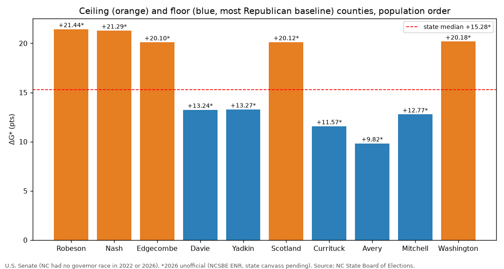
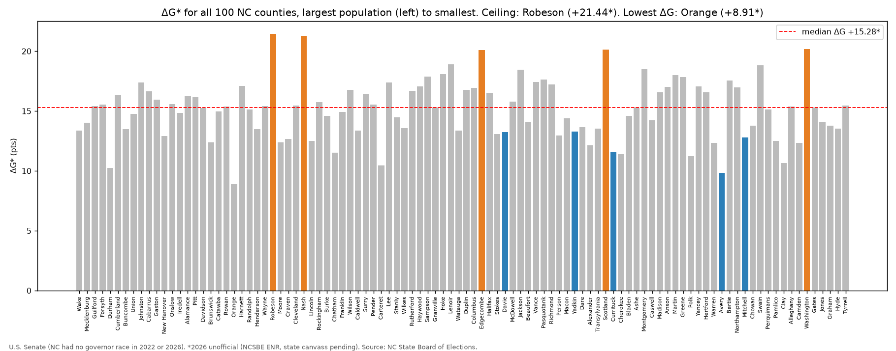

# Floor and Ceiling Counties

> **\*2026 figures are UNOFFICIAL.** The NC State Board of Elections (SBOE) results site labels the Nov 3, 2026 statewide results "UNOFFICIAL" (statewide page last updated November 19, 2026 11:19 am ET (10:19 am CST), snapshot taken 11:52 am CST Nov 19 2026); the state canvass has not been completed. 95 of 100 county pages are marked OFFICIAL (county canvass done); 5 are still unofficial (Forsyth, Robeson, Watauga, Alexander, Anson). 2022 figures are SBOE OFFICIAL/certified results.
>
> **Race: U.S. Senate, not governor.** North Carolina elects its governor in presidential years (2020, 2024), so there was no governor race in 2022 or 2026. The top statewide race in both years was U.S. Senate (2022: Cheri Beasley (D) vs. Ted Budd (R); 2026: Roy Cooper (D) vs. Michael Whatley (R)), and it is used here in place of governor. Votes are votes for the Democratic Senate candidate, not a count of registered Democrats who voted. Registration is the SBOE voter_stats file for each election date (all parties: DEM, REP, UNA, LIB, GRE). These pages measure a pattern; they make no claim about intent, fraud or cause.

## How to read floor and ceiling counties

Look for the pattern at both ends. The ceiling counties are the ones with the highest ΔG; in North Carolina those are Robeson, Nash, Washington, Scotland, Edgecombe. The floor counties are the most Republican baseline counties, where there were the fewest Democrats to move.

- **The floor** by ΔG is the single county with the lowest ΔG in the state. In North Carolina that's Orange, at +8.91\*. No North Carolina county has a negative ΔG, so the floor is the smallest rise, not a decline.
- **The ceiling** is the single county with the highest ΔG in the state. In North Carolina that's Robeson, at +21.44\*.

Every state has its own floor and ceiling. Those two extremes set the range the rest of that state's counties fall within.

## Terminology

- **Ceiling counties** are residual counties with the largest positive ΔG: they lost registered Democrats and moved most. Robeson +21.44\*, Nash +21.29\*, Washington +20.18\*, Scotland +20.12\*, Edgecombe +20.10\*.
- **Floor counties** are the most Republican baseline: the five lowest 2022 Democratic registration shares. Mitchell 9.8% (ΔG +12.77\*), Avery 10.7% (ΔG +9.82\*), Yadkin 12.8% (ΔG +13.27\*), Currituck 14.9% (ΔG +11.57\*), Davie 15.2% (ΔG +13.24\*). By 2022 Democratic vote share instead, the five lowest are Yadkin (17.2%), Graham (17.4%), Randolph (19.2%), Wilkes (19.3%), Alexander (19.7%). Read by ΔG, the five lowest are Orange (+8.91\*), Avery (+9.82\*), Durham (+10.25\*), Carteret (+10.47\*), Clay (+10.65\*); Avery is on both the baseline and ΔG floor lists.
- **Baseline ceiling** (most Democratic registration in 2022): Hertford 65.6%, Northampton 62.7%, Bertie 62.7%, Edgecombe 61.6%, Warren 61.3%. Edgecombe is also a ΔG ceiling county.
- **Non-loss counties** had no Democratic registration loss. Raw numbers only, no residual step:
  - Johnston: registered Democrats 40,603 → 41,935; Democratic Senate votes 28,121 → 46,345\*.
  - Brunswick: registered Democrats 27,657 → 28,496; Democratic Senate votes 26,685 → 39,904\*.
  - Harnett: registered Democrats 24,436 → 24,788; Democratic Senate votes 13,133 → 22,285\*.
- **Registration fell and votes fell too:** none in North Carolina. Democratic Senate votes rose in all 100 counties.
- **Ballots fell, Democratic votes rose** (15 counties): Randolph, Caldwell, Surry, Wilkes, Rutherford, Columbus, Stokes, Yadkin, Alexander, Yancey, Avery, Mitchell, Pamlico, Alleghany, Gates. These are flagged for how their votes moved, not because their ΔG is unusual.

## Ceiling and floor detail

Largest to smallest population.

| County | Group | Population | G 2022 | G 2026\* | ΔG\* | Dem reg share 2022 → 2026 | Dem reg 2022 → 2026 | Dem Senate votes 2022 → 2026\* | Implied extra votes\* |
|---|---|---|---|---|---|---|---|---|---|
| Robeson | Ceiling | 119,941 | −11.48 | +9.95 | +21.44 | 50.6% → 37.8% | 36,366 → 29,590 (−18.6%) | 10,736 → 14,488 | +2,615 |
| Nash | Ceiling | 99,365 | +2.00 | +23.29 | +21.29 | 43.7% → 33.8% | 29,742 → 24,491 (−17.7%) | 16,401 → 23,538 | +4,698 |
| Edgecombe | Ceiling | 49,121 | −2.41 | +17.69 | +20.10 | 61.6% → 51.0% | 21,449 → 18,664 (−13.0%) | 9,213 → 12,453 | +1,720 |
| Davie | Floor | 45,855 | +9.67 | +22.91 | +13.24 | 15.2% → 13.1% | 4,859 → 4,462 (−8.2%) | 4,501 → 6,699 | +2,083 |
| Yadkin | Floor | 38,325 | +4.41 | +17.68 | +13.27 | 12.8% → 10.5% | 3,181 → 2,702 (−15.1%) | 2,400 → 3,843 | +1,496 |
| Scotland | Ceiling | 33,322 | −2.87 | +17.25 | +20.12 | 47.9% → 37.6% | 10,093 → 8,303 (−17.7%) | 4,359 → 5,776 | +1,028 |
| Currituck | Floor | 33,158 | +8.51 | +20.08 | +11.57 | 14.9% → 12.2% | 3,431 → 3,072 (−10.5%) | 2,739 → 4,138 | +1,133 |
| Avery | Floor | 18,110 | +12.47 | +22.29 | +9.82 | 10.7% → 9.1% | 1,355 → 1,134 (−16.3%) | 1,595 → 2,150 | +562 |
| Mitchell | Floor | 15,062 | +10.75 | +23.53 | +12.77 | 9.8% → 8.2% | 1,098 → 924 (−15.8%) | 1,354 → 2,022 | +713 |
| Washington | Ceiling | 10,638 | −10.63 | +9.55 | +20.18 | 59.3% → 49.8% | 4,855 → 4,093 (−15.7%) | 2,002 → 2,720 | +489 |

**Ceiling profile.**
- **Starting G:** 4 of 5 ceiling counties began 2022 with a negative G (Democratic vote share behind registration share) and turned positive in 2026. Statewide, 28 counties flipped from negative to positive; the number of counties with a negative G in 2026 is 0.
- **Registration decline:** Democratic registration fell in 5 of 5, by −13.0% to −18.6%; registration-share drops of 9.52 to 12.82 points; their drops rank 1, 3, 4, 5, 6 of 100 statewide (1 = largest).
- **Region:** all five are in the eastern Coastal Plain / Sandhills or the Nash–Edgecombe corridor (zones: North Central, Northeast, Sandhills). Robeson's 2026 county results were still unofficial at snapshot time.

**Floor profile.** The five floor counties are in the mountains and northwest Piedmont (Mitchell, Avery, Yadkin, Davie) plus Currituck on the northeast coast. All five rose, and 5 of 5 rose less than the statewide median ΔG (+15.28\*).

Statewide, ΔG rose in 100 of 100 counties (median about +15.3).

## Texas-style over-ballot check

Any county where Democratic + Republican U.S. Senate votes exceed total ballots cast.

| Year | Counties checked | Counties where D + R > ballots | Highest (D + R) ÷ ballots | Counties where all Senate votes > ballots |
|---|---|---|---|---|
| 2022 (official) | 100 | **0** | 98.34% (Warren) | 0 (highest 99.83%) |
| 2026\* (unofficial) | 100 | **0** | 98.26% (Durham) | 0 (highest 99.79%) |

**No over-ballot anomalies in either year.** Highest five in 2026\*:

| County | (D + R) ÷ ballots 2022 | 2026\* |
|---|---|---|
| Durham | 97.95% | 98.26% |
| Orange | 98.00% | 98.18% |
| Nash | 98.07% | 98.17% |
| Edgecombe | 98.05% | 98.05% |
| Bertie | 97.91% | 98.03% |

## Regional constants and counties narrowed out

Regional constants do not significantly beat one statewide constant (prosperity zones p = 0.11; broad regions p = 0.08). Seven counties were narrowed out of the constant fit: Nash, Orange, Warren, Cabarrus, Johnston (high influence, Cook's distance above 4/n) and Brunswick, Harnett (non-loss). Full tables on [Locked North Carolina Formula](Locked-North-Carolina-Formula#regional-constants).

*Ceiling (orange) and floor (blue, most Republican baseline) counties in population order, with the state median ΔG.*

*All 100 counties, ΔG in population order. Orange: ceiling (5 largest ΔG). Blue: floor (5 lowest 2022 Democratic registration share). Dashed red line: state median.*

---
**Related:** [Home](Home) · [Bottom-Up Reverse Math](Reverse-Math) · [Locked North Carolina Formula](Locked-North-Carolina-Formula) · [Graphs](Graphs) · [Cedar County Audit (Nebraska)](https://github.com/mbenson8989/Nebraska-Election-Analysis-/wiki/Cedar-Audit)
