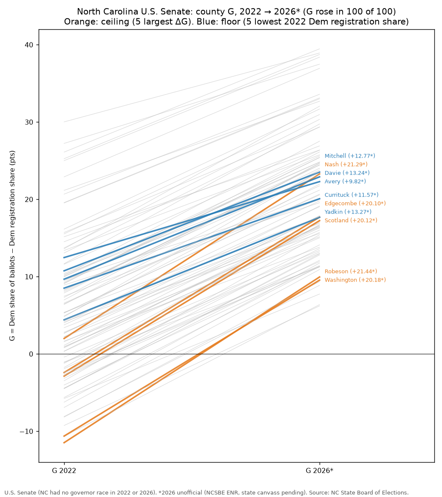
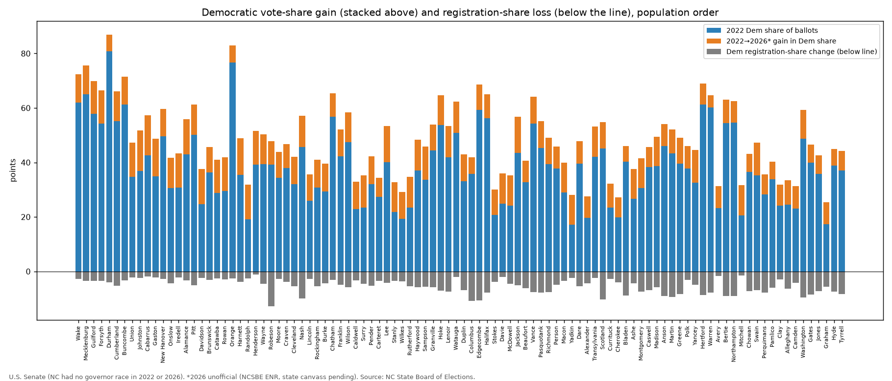
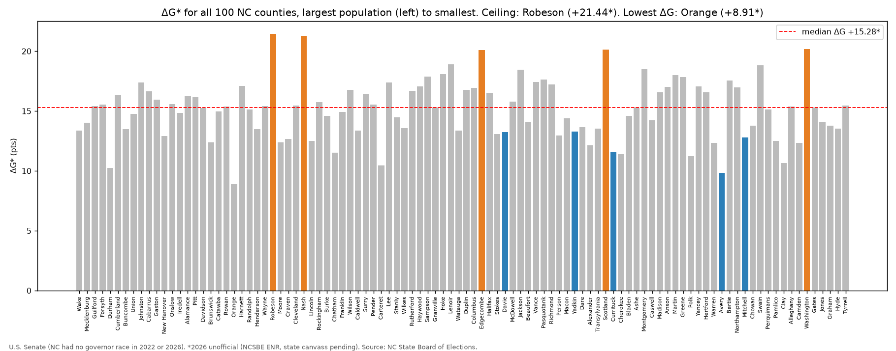
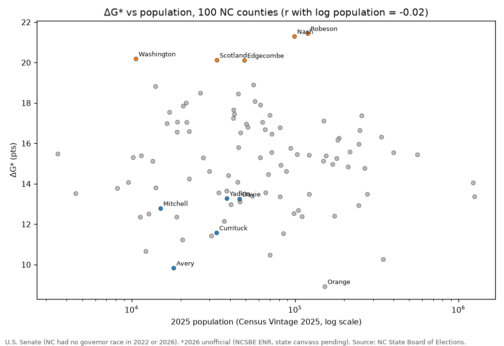
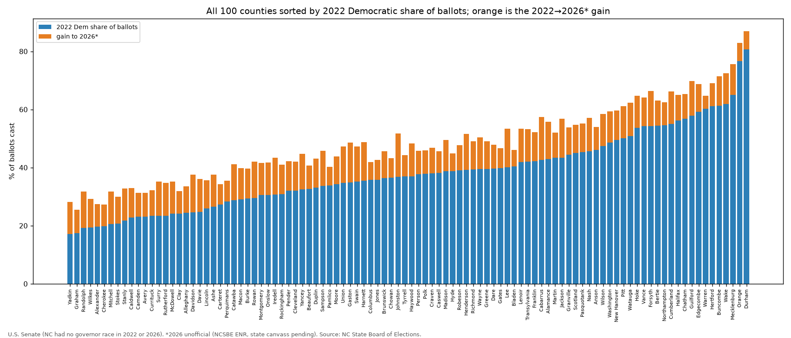
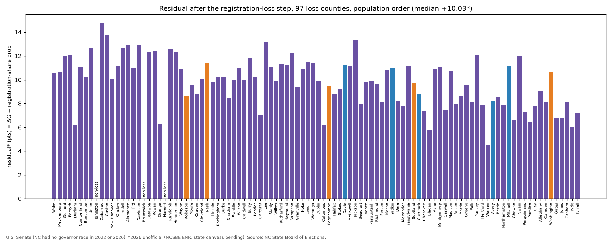
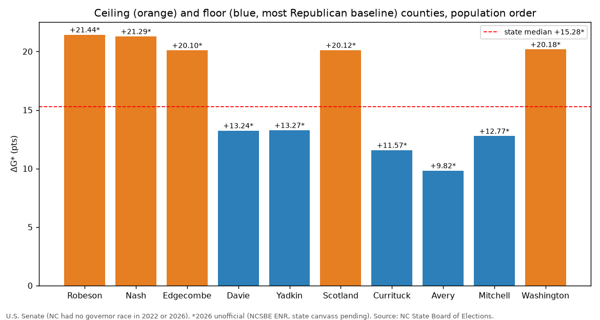
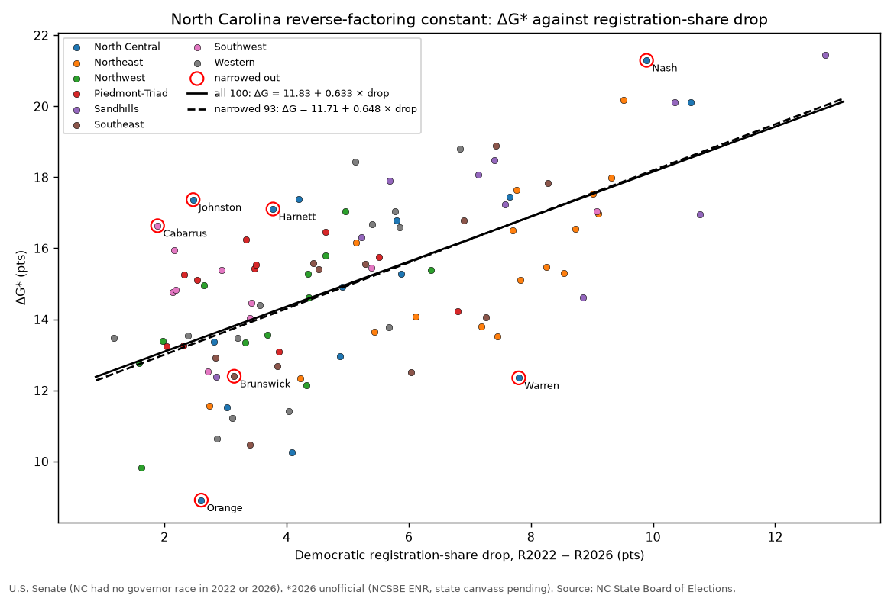
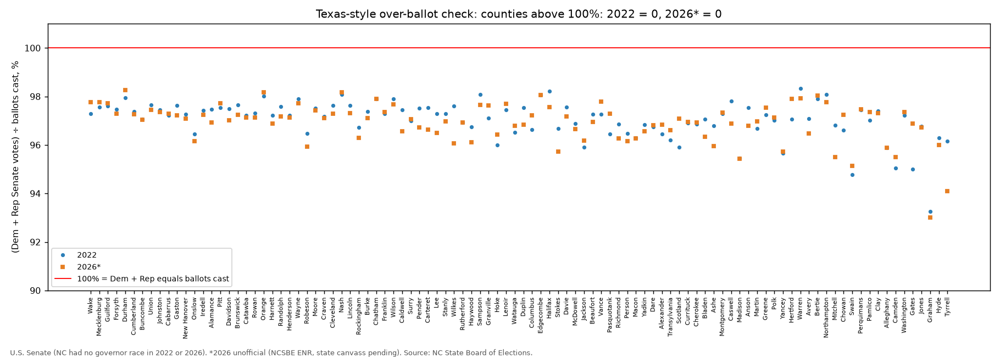
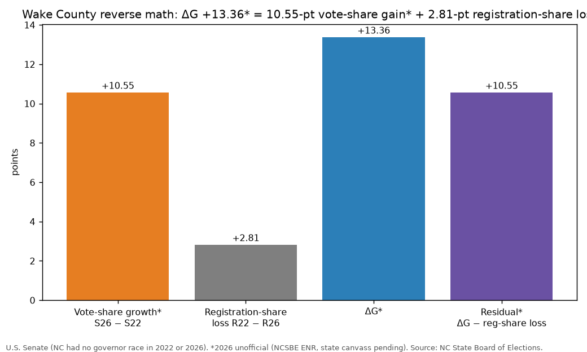

# Graphs

> **\*2026 figures are UNOFFICIAL.** The NC State Board of Elections (SBOE) results site labels the Nov 3, 2026 statewide results "UNOFFICIAL" (statewide page last updated November 19, 2026 11:19 am ET (10:19 am CST), snapshot taken 11:52 am CST Nov 19 2026); the state canvass has not been completed. 95 of 100 county pages are marked OFFICIAL (county canvass done); 5 are still unofficial (Forsyth, Robeson, Watauga, Alexander, Anson). 2022 figures are SBOE OFFICIAL/certified results.
>
> **Race: U.S. Senate, not governor.** North Carolina elects its governor in presidential years (2020, 2024), so there was no governor race in 2022 or 2026. The top statewide race in both years was U.S. Senate (2022: Cheri Beasley (D) vs. Ted Budd (R); 2026: Roy Cooper (D) vs. Michael Whatley (R)), and it is used here in place of governor. Votes are votes for the Democratic Senate candidate, not a count of registered Democrats who voted. Registration is the SBOE voter_stats file for each election date (all parties: DEM, REP, UNA, LIB, GRE). These pages measure a pattern; they make no claim about intent, fraud or cause.

## 1. County slope chart

*Each line is one county, G 2022 to G 2026\*. G rose in 100 of 100 counties. Ceiling counties orange, floor counties blue, labeled with ΔG.*

## 2. Stacked bars: vote-share gain and registration-share loss

*2022 Democratic share of ballots plus the 2026\* gain (above the line) and the registration-share change (below the line), all 100 counties in population order.*

## 3. ΔG by population and ΔG scatter

*All 100 counties in population order. Lowest ΔG: Orange (+8.91\*). Ceiling: Robeson (+21.44\*).*

*ΔG\* against population (log scale), 100 counties (r with log population = -0.02). Treat as a pattern, not a conclusion.*

## 4. Vote-share gain bars sorted by 2022 Democratic share

*All 100 counties sorted by 2022 Democratic share of ballots. Blue is the 2022 share; orange is the 2022 to 2026 gain\*.*

## 5. Residual after the registration-loss step

*Residual\* = ΔG − registration-share drop for the 97 loss counties, population order; non-loss counties (Johnston, Brunswick, Harnett) shown as zero and labeled.*

## 6. Ceiling and floor counties

*Ceiling: Robeson +21.44\*, Nash +21.29\*, Washington +20.18\*, Scotland +20.12\*, Edgecombe +20.10\*. Floor (most Republican baseline): Mitchell +12.77\*, Avery +9.82\*, Yadkin +13.27\*, Currituck +11.57\*, Davie +13.24\*.*

## 7. North Carolina constant

*ΔG\* against registration-share drop: ΔG = 11.83 + 0.633 × drop (all 100) and 11.71 + 0.648 × drop (narrowed 93). Colors are prosperity zones.*

## 8. Texas-style over-ballot check

*(Democratic + Republican Senate votes) ÷ ballots cast, every county, 2022 and 2026\*. No county reaches 100% (2022: 0, 2026\*: 0).*

## 9. Wake County

*Wake reverse math: ΔG +13.36\* = 10.55-point vote-share gain\* + 2.81-point registration-share loss.*

---
**Related:** [Home](Home) · [Bottom-Up Reverse Math](Reverse-Math) · [Floor and Ceiling Counties](Floor-and-Ceiling) · [Locked North Carolina Formula](Locked-North-Carolina-Formula) · [Cedar County Audit (Nebraska)](https://github.com/mbenson8989/Nebraska-Election-Analysis-/wiki/Cedar-Audit)
