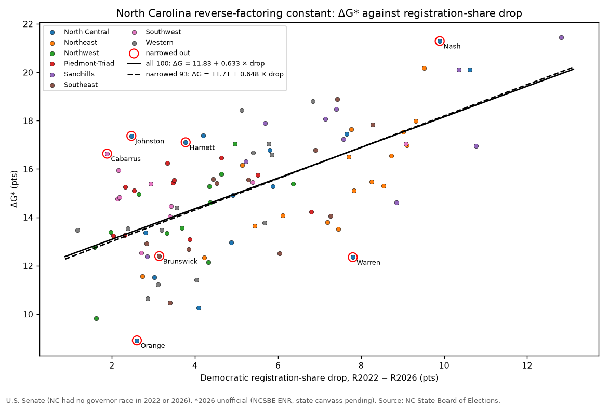

# Locked North Carolina Formula

> **\*2026 figures are UNOFFICIAL.** The NC State Board of Elections (SBOE) results site labels the Nov 3, 2026 statewide results "UNOFFICIAL" (statewide page last updated November 19, 2026 11:19 am ET (10:19 am CST), snapshot taken 11:52 am CST Nov 19 2026); the state canvass has not been completed. 95 of 100 county pages are marked OFFICIAL (county canvass done); 5 are still unofficial (Forsyth, Robeson, Watauga, Alexander, Anson). 2022 figures are SBOE OFFICIAL/certified results.
>
> **Race: U.S. Senate, not governor.** North Carolina elects its governor in presidential years (2020, 2024), so there was no governor race in 2022 or 2026. The top statewide race in both years was U.S. Senate (2022: Cheri Beasley (D) vs. Ted Budd (R); 2026: Roy Cooper (D) vs. Michael Whatley (R)), and it is used here in place of governor. Votes are votes for the Democratic Senate candidate, not a count of registered Democrats who voted. Registration is the SBOE voter_stats file for each election date (all parties: DEM, REP, UNA, LIB, GRE). These pages measure a pattern; they make no claim about intent, fraud or cause.

## The equation

- **S** (Democratic vote share) = Democratic U.S. Senate votes ÷ total ballots cast (SBOE county "ballots cast") × 100
- **R** (Democratic registration share) = Democratic registered voters ÷ total registered voters (all parties, SBOE voter_stats for the election date) × 100
- **G** = S − R
- **ΔG** = G(2026) − G(2022) = (S2026 − S2022) − (R2026 − R2022)
- **Reverse step (registration-loss subtraction):** residual = ΔG − (R2022 − R2026) = S2026 − S2022, the vote-share growth left after subtracting the expected loss from the registration-share decline
- **Solved backward, implied extra (injected/offset) votes:** residual × ballots2026 ÷ 100 = D2026 − (S2022 ÷ 100) × ballots2026
- **Registration-scaled gap** (the Nebraska wiki's "gap in votes" line, for comparison only): D2026 − D2022 × (RegDem2026 ÷ RegDem2022)

**Race.** U.S. Senate in both years, substituted for governor because North Carolina had no governor race in 2022 or 2026.

**Denominator.** Total ballots cast as reported by SBOE for each county (2022 official; 2026\* unofficial). Total Senate votes (all candidates incl. write-ins) were 3,773,924 of 3,790,202 ballots in 2022 and 4,222,288\* of 4,242,644\* in 2026.

## Blank template

| Line | Item | 2022 | 2026* |
|---|---|---|---|
| 1 | Democratic U.S. Senate votes | ______ | ______ |
| 2 | Total ballots cast (SBOE county figure) | ______ | ______ |
| 3 | S = line 1 ÷ line 2 × 100 | ______ | ______ |
| 4 | Democratic registered voters (SBOE voter_stats, election date) | ______ | ______ |
| 5 | Total registered voters, all parties (same file) | ______ | ______ |
| 6 | R = line 4 ÷ line 5 × 100 | ______ | ______ |
| 7 | G = line 3 − line 6 | ______ | ______ |
| 8 | ΔG = G 2026 − G 2022 | | ______ |
| 9 | Registration-share change = R 2026 − R 2022 | | ______ |
| 10 | Did Democratic registration fall? (line 4: 2026 < 2022) | | Yes / No |
| 11 | If yes: residual = line 8 − \|line 9\| | | ______ |
| 12 | Implied extra votes = line 1 (2026) − line 3 (2022) ÷ 100 × line 2 (2026) | | ______ |
| 13 | Registration-scaled gap = line 1 (2026) − line 1 (2022) × (line 4 2026 ÷ line 4 2022) | | ______ |

## Rules for using this formula

1. **If a county lost Democratic registration, run the residual step.** Subtract the registration-share loss from ΔG (line 11) and solve backward for implied extra votes (line 12). In North Carolina, 97 of 100 counties lost registered Democrats. The exceptions are Johnston (40,603 → 41,935), Brunswick (27,657 → 28,496), Harnett (24,436 → 24,788), the **non-loss counties**: report their raw numbers. Their registration *share* still fell, because total registration grew faster.
2. **The starting point is different in every state. Don't assume Nebraska's numbers carry over.** North Carolina's statewide ΔG was +15.43\* and its county median +15.28\*. Compare North Carolina counties with North Carolina's own range, not with another state's.
3. **Always pull out the ceiling and floor counties.** In North Carolina the ceiling county is Robeson (+21.44\*) and the lowest ΔG is Orange (+8.91\*). No North Carolina county has a negative ΔG. See [Floor and Ceiling Counties](Floor-and-Ceiling).

**Terms used in this wiki** (full definitions on [Floor and Ceiling Counties](Floor-and-Ceiling#terminology)):
- **Ceiling counties**: the five largest ΔG (Robeson, Nash, Washington, Scotland, Edgecombe).
- **Floor counties**: the most Republican baseline, the five lowest 2022 Democratic registration shares (Mitchell, Avery, Yadkin, Currituck, Davie).
- **Non-loss counties**: no Democratic registration loss (Johnston, Brunswick, Harnett). Raw numbers only.

## Worked example: Wake

| Line | Item | 2022 | 2026* |
|---|---|---|---|
| 1 | Democratic U.S. Senate votes | 281,367 | 381,791* |
| 2 | Total ballots cast | 454,488 | 526,897* |
| 3 | S | 61.91 | 72.46* |
| 4 | Democratic registered | 291,321 | 286,985 |
| 5 | Total registered | 813,767 | 869,883 |
| 6 | R | 35.80 | 32.99 |
| 7 | G | +26.11 | +39.47* |
| 8 | ΔG | | +13.36* |
| 9 | Registration-share change | | −2.81 |
| 10 | Registration fell? | | Yes |
| 11 | Residual | | 10.55* |
| 12 | Implied extra votes | | +55,597* |
| 13 | Registration-scaled gap | | +104,612* |

## The North Carolina reverse-factoring constant (NC data only)

Recomputed from North Carolina's own 100 counties; no other state's constant is used. Ordinary least squares, each county weighted equally, ΔG against the registration-share drop (R2022 − R2026, points), the same form as the South Dakota constant:

| Fit | Counties | Constant c (SE) | Slope k (SE) | R² | Residual SD (pts) |
|---|---|---|---|---|---|
| **All counties** | 100 | **+11.83** (0.44) | **0.633** (0.077) | 0.41 | 1.93 |
| Narrowed (7 counties out, see below) | 93 | +11.71 (0.42) | 0.648 (0.073) | 0.47 | 1.74 |

**Locked North Carolina formula: ΔG ≈ 11.83 + 0.633 × (registration-share drop)\*.** 95% CI for c: 10.94 to 12.71; for k: 0.481 to 0.785. Read it this way: a county with no registration-share drop would be expected to show a ΔG of about 11.8 points; each point of registration-share drop adds about 0.63 points. The intercept is the statewide swing in Democratic vote share that registration change does not explain. Because k is below 1, ΔG grows less than one-for-one with registration loss.

### Forward surplus fit (for comparison with the other state wikis)

G = m × (R ÷ 100) + b, each year, all 100 counties, equal weight.

| Year | m (SE) | b | R² | Residual SE | Within ±1 / ±2 / ±3 pts | m, b weighted by ballots |
|---|---|---|---|---|---|---|
| 2022 | -25.4 (6.2) | +13.89 | 0.15 | 8.33 | 11% / 26% / 34% | +20.8, +6.70 |
| 2026\* | -12.6 (6.7) | +24.18 | 0.04 | 7.86 | 9% / 13% / 26% | +35.0, +18.09 |

The forward fit is weak in North Carolina (registration share explains 15% of county differences in G in 2022 and 4% in 2026\*), and the slope changes sign when weighted by ballots, so m is not a stable constant here. The change fit ΔG = m × (R2022 ÷ 100) + b gives m = 8.84, b = +12.24 (R² 0.23).

### Regional constants

Same ΔG-on-drop fit, run within each NC Commerce Prosperity Zone and within a three-region roll-up (Mountains = Western + Northwest zones; Piedmont = Southwest + Piedmont-Triad + North Central; Coastal Plain = Sandhills + Northeast + Southeast). "Mean deviation" is the zone's average distance above (+) or below (−) the single statewide line.

| Prosperity Zone | Counties | c | k | R² | Mean ΔG\* | Mean deviation from statewide line |
|---|---|---|---|---|---|---|
| Southwest | 10 | +14.24 | 0.245 | 0.17 | +15.11 | +1.05 |
| Piedmont-Triad | 11 | +14.18 | 0.189 | 0.05 | +14.88 | +0.73 |
| Sandhills | 10 | +12.42 | 0.626 | 0.51 | +17.35 | +0.54 |
| Western | 13 | +9.64 | 1.167 | 0.52 | +14.58 | +0.07 |
| North Central | 15 | +10.64 | 0.839 | 0.38 | +15.14 | −0.08 |
| Northwest | 12 | +10.81 | 0.877 | 0.45 | +14.01 | −0.13 |
| Southeast | 12 | +9.37 | 0.988 | 0.54 | +14.59 | −0.58 |
| Northeast | 17 | +8.86 | 0.917 | 0.64 | +15.55 | −0.89 |

| Broad region | Counties | c | k | R² | Mean ΔG\* | Mean deviation from statewide line |
|---|---|---|---|---|---|---|
| Coastal Plain | 39 | +10.17 | 0.812 | 0.58 | +15.72 | −0.43 |
| Mountains | 25 | +10.17 | 1.045 | 0.49 | +14.31 | −0.02 |
| Piedmont | 36 | +12.83 | 0.513 | 0.24 | +15.05 | +0.48 |

**Result:** regional intercepts do not significantly improve on one statewide constant. Zone intercepts: RMSE 1.88 vs 1.93, F-test p = 0.11 (narrowed set: p = 0.08). Broad regions: RMSE 1.90, p = 0.08. The Southwest (Charlotte metro) and Piedmont-Triad zones sit about +1.0 and +0.7 points above the line; the Northeast and Southeast sit about −0.9 and −0.6 below. These are leanings, not separate constants. Within-zone slopes vary widely (k from 0.19 to 1.17) on 10 to 17 counties each, so they are not stable enough to lock.

### Counties narrowed out of the fit

| County | Reason |
|---|---|
| Nash | High influence on the statewide fit (Cook's distance 0.067, above 4/n = 0.04); ΔG +21.29\*, registration-share drop 9.90 |
| Orange | High influence on the statewide fit (Cook's distance 0.060, above 4/n = 0.04); ΔG +8.91\*, registration-share drop 2.60 |
| Warren | High influence on the statewide fit (Cook's distance 0.056, above 4/n = 0.04); ΔG +12.35\*, registration-share drop 7.80 |
| Cabarrus | High influence on the statewide fit (Cook's distance 0.051, above 4/n = 0.04); ΔG +16.64\*, registration-share drop 1.89 |
| Johnston | High influence on the statewide fit (Cook's distance 0.048, above 4/n = 0.04); ΔG +17.37\*, registration-share drop 2.47 |
| Brunswick | Non-loss county (gained registered Democrats): raw numbers only, no residual step |
| Harnett | Non-loss county (gained registered Democrats): raw numbers only, no residual step |

Johnston is both influential and non-loss. Narrowing these 7 counties moves the constant only slightly (c 11.83 → 11.71, k 0.633 → 0.648); they do not drive the result. Orange (Chapel Hill, the lowest ΔG) and Nash (second-highest ΔG) are the two ends that pull hardest.

*ΔG\* against registration-share drop, colored by prosperity zone; narrowed counties circled.*

---
**Related:** [Home](Home) · [Bottom-Up Reverse Math](Reverse-Math) · [Floor and Ceiling Counties](Floor-and-Ceiling) · [Graphs](Graphs) · [Cedar County Audit (Nebraska)](https://github.com/mbenson8989/Nebraska-Election-Analysis-/wiki/Cedar-Audit)
