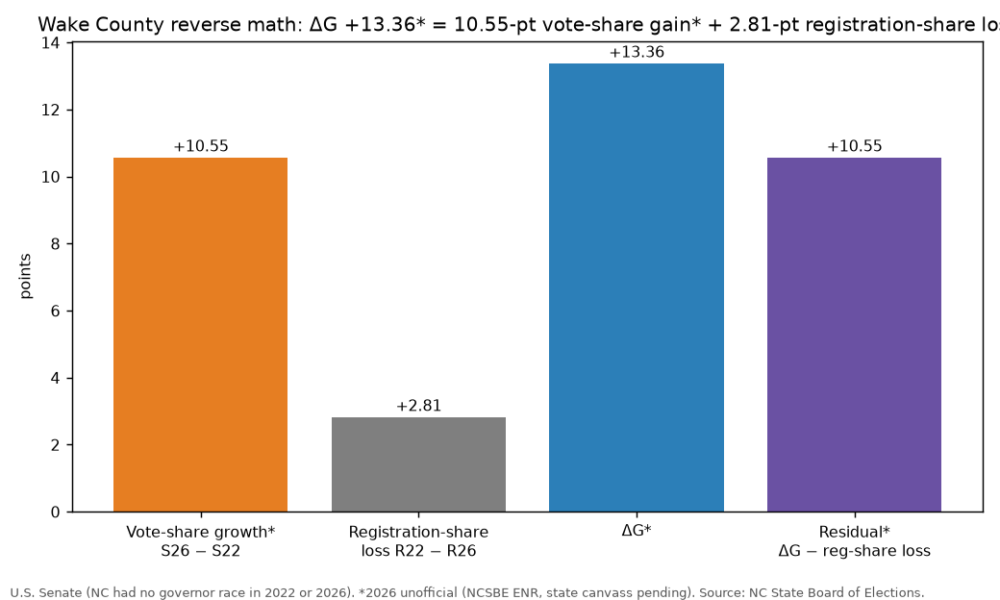

# Bottom-Up Reverse Math

> **\*2026 figures are UNOFFICIAL.** The NC State Board of Elections (SBOE) results site labels the Nov 3, 2026 statewide results "UNOFFICIAL" (statewide page last updated November 19, 2026 11:19 am ET (10:19 am CST), snapshot taken 11:52 am CST Nov 19 2026); the state canvass has not been completed. 95 of 100 county pages are marked OFFICIAL (county canvass done); 5 are still unofficial (Forsyth, Robeson, Watauga, Alexander, Anson). 2022 figures are SBOE OFFICIAL/certified results.
>
> **Race: U.S. Senate, not governor.** North Carolina elects its governor in presidential years (2020, 2024), so there was no governor race in 2022 or 2026. The top statewide race in both years was U.S. Senate (2022: Cheri Beasley (D) vs. Ted Budd (R); 2026: Roy Cooper (D) vs. Michael Whatley (R)), and it is used here in place of governor. Votes are votes for the Democratic Senate candidate, not a count of registered Democrats who voted. Registration is the SBOE voter_stats file for each election date (all parties: DEM, REP, UNA, LIB, GRE). These pages measure a pattern; they make no claim about intent, fraud or cause.

The same arithmetic at three levels, from one county up to the whole state. Total-ballots denominator (SBOE "ballots cast" per county), U.S. Senate race.

## Step 1: Wake County

| Step | Value |
|---|---|
| Democratic vote share (S) | 61.91% (2022) → 72.46%\* (2026): **+10.55 points\*** |
| Democratic registration share (R) | 35.80% → 32.99%: **−2.81 points** |
| ΔG = vote-share growth − registration-share change | 10.55 − (−2.81) = **+13.36 points\*** |
| Reverse step: ΔG − registration-share loss | 13.36 − 2.81 = **10.55** (the residual) |
| Solved backward: implied extra votes | 381,791\* − 61.9086% × 526,897\* = **about +55,597\*** |
| Registration-scaled gap (Nebraska "gap in votes" line, comparison only) | 381,791\* − 281,367 × (286,985 ÷ 291,321) = **about +104,612\*** |

## Step 2: the ten largest counties

Largest to smallest population (Census Vintage 2025).

| County | Population | Dem reg 2022 → 2026 | Dem Senate votes 2022 → 2026\* | Ballots 2022 → 2026\* | S 2022 → 2026\* | R 2022 → 2026 | ΔG\* | Residual\* | Implied extra votes\* |
|---|---|---|---|---|---|---|---|---|---|
| Wake | 1,257,235 | 291,321 → 286,985 | 281,367 → 381,791 | 454,488 → 526,897 | 61.91% → 72.46% | 35.80% → 32.99% | +13.36 | +10.55 | +55,597 |
| Mecklenburg | 1,233,383 | 337,304 → 329,482 | 234,787 → 334,972 | 361,299 → 442,918 | 64.98% → 75.63% | 42.08% → 38.68% | +14.04 | +10.64 | +47,146 |
| Guilford | 562,234 | 160,472 → 154,758 | 108,688 → 152,876 | 187,714 → 218,806 | 57.90% → 69.87% | 42.37% → 38.90% | +15.44 | +11.97 | +26,185 |
| Forsyth | 401,718 | 103,228 → 96,616 | 73,524 → 102,553 | 135,305 → 154,506 | 54.34% → 66.37% | 38.20% → 34.69% | +15.54 | +12.04 | +18,595 |
| Durham | 347,240 | 128,469 → 125,523 | 103,630 → 132,002 | 128,364 → 151,904 | 80.73% → 86.90% | 53.50% → 49.41% | +10.25 | +6.17 | +9,368 |
| Cumberland | 338,473 | 88,947 → 83,779 | 46,449 → 63,592 | 84,327 → 96,102 | 55.08% → 66.17% | 42.02% → 36.80% | +16.31 | +11.09 | +10,657 |
| Buncombe | 277,417 | 75,705 → 72,408 | 73,807 → 94,675 | 120,558 → 132,419 | 61.22% → 71.50% | 35.96% → 32.76% | +13.48 | +10.28 | +13,607 |
| Union | 267,674 | 39,360 → 39,174 | 31,354 → 48,001 | 90,350 → 101,406 | 34.70% → 47.34% | 23.10% → 20.97% | +14.76 | +12.63 | +12,810 |
| Johnston | 256,448 | 40,603 → 41,935 | 28,121 → 46,345 | 76,300 → 89,550 | 36.86% → 51.75% | 26.70% → 24.23% | +17.37 | non-loss | n/a |
| Cabarrus | 249,725 | 44,354 → 44,353 | 32,372 → 50,300 | 75,957 → 87,683 | 42.62% → 57.37% | 28.91% → 27.02% | +16.64 | +14.75 | +12,931 |

ΔG is positive in all ten (+10.25 to +17.37). Johnston is a non-loss county (registered Democrats rose), so it gets raw numbers only. Cabarrus lost a single registered Democrat (44,354 → 44,353), so by the rule it runs the residual step.

## Step 3: all 100 counties

| Group | Counties | Pooled S\* | Pooled R | Vote-share growth\* | Reg-share change | Pooled ΔG\* | County mean ΔG\* (range) | Implied extra votes\* |
|---|---|---|---|---|---|---|---|---|
| Ten largest counties | 10 | 59.14% → 70.28%\* | 38.49% → 35.18% | +11.14 | −3.32 | +14.45 | +14.72 (+10.25 to +17.37) | +206,895 (9 loss counties) |
| Other 90 counties | 90 | 37.10% → 47.92%\* | 29.71% → 25.07% | +10.82 | −4.64 | +15.46 | +15.17 (+8.91 to +21.44) | +220,674 (88 loss counties) |
| All 100 counties | 100 | 47.07% → 58.47%\* | 33.74% → 29.71% | +11.40 | −4.03 | +15.43 | +15.12 (+8.91 to +21.44) | +427,569 (97 loss counties) |

ΔG is positive in all 100 counties; Democratic registration share fell in all 100. 97 counties lost registered Democrats and run the residual step; Johnston, Brunswick, Harnett did not.

### All 100 counties, largest to smallest

| County | Population | Dem reg 2022 → 2026 | Dem Senate votes 2022 → 2026\* | Ballots 2022 → 2026\* | S 2022 → 2026\* | R 2022 → 2026 | ΔG\* | Residual\* | Implied extra votes\* |
|---|---|---|---|---|---|---|---|---|---|
| Wake | 1,257,235 | 291,321 → 286,985 | 281,367 → 381,791 | 454,488 → 526,897 | 61.91% → 72.46% | 35.80% → 32.99% | +13.36 | +10.55 | +55,597 |
| Mecklenburg | 1,233,383 | 337,304 → 329,482 | 234,787 → 334,972 | 361,299 → 442,918 | 64.98% → 75.63% | 42.08% → 38.68% | +14.04 | +10.64 | +47,146 |
| Guilford | 562,234 | 160,472 → 154,758 | 108,688 → 152,876 | 187,714 → 218,806 | 57.90% → 69.87% | 42.37% → 38.90% | +15.44 | +11.97 | +26,185 |
| Forsyth | 401,718 | 103,228 → 96,616 | 73,524 → 102,553 | 135,305 → 154,506 | 54.34% → 66.37% | 38.20% → 34.69% | +15.54 | +12.04 | +18,595 |
| Durham | 347,240 | 128,469 → 125,523 | 103,630 → 132,002 | 128,364 → 151,904 | 80.73% → 86.90% | 53.50% → 49.41% | +10.25 | +6.17 | +9,368 |
| Cumberland | 338,473 | 88,947 → 83,779 | 46,449 → 63,592 | 84,327 → 96,102 | 55.08% → 66.17% | 42.02% → 36.80% | +16.31 | +11.09 | +10,657 |
| Buncombe | 277,417 | 75,705 → 72,408 | 73,807 → 94,675 | 120,558 → 132,419 | 61.22% → 71.50% | 35.96% → 32.76% | +13.48 | +10.28 | +13,607 |
| Union | 267,674 | 39,360 → 39,174 | 31,354 → 48,001 | 90,350 → 101,406 | 34.70% → 47.34% | 23.10% → 20.97% | +14.76 | +12.63 | +12,810 |
| Johnston | 256,448 | 40,603 → 41,935 | 28,121 → 46,345 | 76,300 → 89,550 | 36.86% → 51.75% | 26.70% → 24.23% | +17.37 | non-loss | n/a |
| Cabarrus | 249,725 | 44,354 → 44,353 | 32,372 → 50,300 | 75,957 → 87,683 | 42.62% → 57.37% | 28.91% → 27.02% | +16.64 | +14.75 | +12,931 |
| Gaston | 246,558 | 41,570 → 41,052 | 25,676 → 40,600 | 73,684 → 83,476 | 34.85% → 48.64% | 26.78% → 24.62% | +15.96 | +13.79 | +11,512 |
| New Hanover | 245,959 | 52,129 → 49,837 | 46,785 → 61,974 | 94,366 → 103,870 | 49.58% → 59.66% | 28.91% → 26.08% | +12.92 | +10.09 | +10,477 |
| Onslow | 217,175 | 24,406 → 22,132 | 13,544 → 21,235 | 44,218 → 50,846 | 30.63% → 41.76% | 20.59% → 16.15% | +15.57 | +11.13 | +5,661 |
| Iredell | 211,798 | 28,063 → 28,055 | 21,442 → 33,064 | 69,830 → 76,271 | 30.71% → 43.35% | 20.73% → 18.54% | +14.83 | +12.64 | +9,644 |
| Alamance | 186,177 | 38,335 → 37,163 | 25,866 → 38,359 | 60,253 → 68,696 | 42.93% → 55.84% | 33.78% → 30.44% | +16.25 | +12.91 | +8,869 |
| Pitt | 182,936 | 49,007 → 45,910 | 27,705 → 38,784 | 55,222 → 63,387 | 50.17% → 61.19% | 40.90% → 35.76% | +16.15 | +11.02 | +6,983 |
| Davidson | 180,182 | 22,166 → 20,982 | 14,643 → 22,991 | 59,523 → 61,258 | 24.60% → 37.53% | 19.27% → 16.95% | +15.25 | +12.93 | +7,921 |
| Brunswick | 174,702 | 27,657 → 28,496 | 26,685 → 39,904 | 73,316 → 87,409 | 36.40% → 45.65% | 21.88% → 18.74% | +12.40 | non-loss | n/a |
| Catawba | 170,172 | 21,356 → 20,009 | 16,076 → 24,886 | 55,876 → 60,578 | 28.77% → 41.08% | 19.30% → 16.66% | +14.96 | +12.31 | +7,457 |
| Rowan | 155,096 | 23,667 → 21,928 | 14,282 → 21,470 | 48,352 → 51,149 | 29.54% → 41.98% | 24.25% → 21.31% | +15.38 | +12.44 | +6,362 |
| Orange | 152,498 | 52,012 → 50,378 | 51,125 → 60,186 | 66,669 → 72,520 | 76.68% → 82.99% | 46.67% → 44.06% | +8.91 | +6.31 | +4,574 |
| Harnett | 150,137 | 24,436 → 24,788 | 13,133 → 22,285 | 37,020 → 45,664 | 35.48% → 48.80% | 29.07% → 25.29% | +17.11 | non-loss | n/a |
| Randolph | 149,516 | 15,867 → 13,968 | 9,313 → 15,280 | 48,512 → 48,080 | 19.20% → 31.78% | 16.52% → 13.98% | +15.12 | +12.58 | +6,050 |
| Henderson | 122,375 | 17,557 → 17,285 | 20,167 → 29,487 | 51,387 → 57,207 | 39.25% → 51.54% | 19.72% → 18.54% | +13.48 | +12.30 | +7,036 |
| Wayne | 122,278 | 28,166 → 25,393 | 13,990 → 19,649 | 35,459 → 39,027 | 39.45% → 50.35% | 37.23% → 32.71% | +15.41 | +10.89 | +4,251 |
| Robeson | 119,941 | 36,366 → 29,590 | 10,736 → 14,488 | 27,435 → 30,340 | 39.13% → 47.75% | 50.61% → 37.80% | +21.44 | +8.62 | +2,615 |
| Moore | 110,619 | 15,852 → 14,872 | 14,586 → 19,808 | 42,514 → 45,185 | 34.31% → 43.84% | 20.93% → 18.08% | +12.37 | +9.53 | +4,306 |
| Craven | 105,025 | 20,404 → 18,628 | 14,101 → 19,765 | 37,130 → 42,224 | 37.98% → 46.81% | 27.69% → 23.85% | +12.68 | +8.83 | +3,729 |
| Cleveland | 103,325 | 21,080 → 18,007 | 10,557 → 14,673 | 32,996 → 34,895 | 31.99% → 42.05% | 31.13% → 25.74% | +15.45 | +10.05 | +3,508 |
| Nash | 99,365 | 29,742 → 24,491 | 16,401 → 23,538 | 35,889 → 41,226 | 45.70% → 57.10% | 43.70% → 33.81% | +21.29 | +11.40 | +4,698 |
| Lincoln | 98,654 | 12,237 → 11,144 | 9,418 → 13,751 | 36,410 → 38,538 | 25.87% → 35.68% | 18.40% → 15.69% | +12.52 | +9.82 | +3,783 |
| Rockingham | 94,195 | 18,534 → 15,825 | 10,110 → 14,218 | 32,802 → 34,631 | 30.82% → 41.06% | 30.03% → 24.51% | +15.75 | +10.23 | +3,544 |
| Burke | 88,655 | 13,474 → 11,230 | 8,847 → 12,032 | 30,093 → 30,347 | 29.40% → 39.65% | 22.82% → 18.46% | +14.61 | +10.25 | +3,110 |
| Chatham | 85,111 | 21,436 → 21,202 | 22,493 → 28,322 | 39,600 → 43,370 | 56.80% → 65.30% | 35.64% → 32.61% | +11.53 | +8.50 | +3,688 |
| Franklin | 82,037 | 17,159 → 16,749 | 11,701 → 17,450 | 27,744 → 33,440 | 42.17% → 52.18% | 33.90% → 29.00% | +14.92 | +10.01 | +3,347 |
| Wilson | 81,150 | 25,651 → 22,488 | 12,503 → 17,171 | 26,364 → 29,402 | 47.42% → 58.40% | 46.30% → 40.51% | +16.77 | +10.98 | +3,227 |
| Caldwell | 81,105 | 10,083 → 8,562 | 6,404 → 9,060 | 28,021 → 27,554 | 22.85% → 32.88% | 18.56% → 15.23% | +13.35 | +10.03 | +2,763 |
| Surry | 72,287 | 9,861 → 7,876 | 5,828 → 8,595 | 24,876 → 24,381 | 23.43% → 35.25% | 20.75% → 16.12% | +16.46 | +11.82 | +2,883 |
| Pender | 72,111 | 11,375 → 10,181 | 7,548 → 10,955 | 23,599 → 25,933 | 31.98% → 42.24% | 23.75% → 18.46% | +15.55 | +10.26 | +2,660 |
| Carteret | 70,469 | 9,682 → 8,320 | 8,827 → 12,200 | 32,329 → 35,498 | 27.30% → 34.37% | 17.69% → 14.29% | +10.47 | +7.06 | +2,508 |
| Lee | 70,258 | 12,941 → 12,117 | 7,767 → 11,435 | 19,331 → 21,428 | 40.18% → 53.36% | 32.87% → 28.67% | +17.39 | +13.19 | +2,825 |
| Stanly | 68,830 | 8,844 → 7,969 | 5,163 → 8,092 | 23,733 → 24,683 | 21.75% → 32.78% | 20.18% → 16.76% | +14.46 | +11.03 | +2,722 |
| Wilkes | 66,233 | 7,303 → 5,838 | 4,770 → 6,963 | 24,655 → 23,829 | 19.35% → 29.22% | 16.53% → 12.85% | +13.56 | +9.87 | +2,353 |
| Rutherford | 65,745 | 10,783 → 8,425 | 5,538 → 8,035 | 23,591 → 23,119 | 23.48% → 34.75% | 23.12% → 17.72% | +16.68 | +11.28 | +2,608 |
| Haywood | 63,369 | 12,833 → 10,804 | 9,972 → 13,791 | 26,927 → 28,551 | 37.03% → 48.30% | 27.94% → 22.17% | +17.04 | +11.27 | +3,218 |
| Sampson | 61,504 | 13,268 → 11,358 | 6,045 → 8,559 | 17,965 → 18,667 | 33.65% → 45.85% | 34.87% → 29.18% | +17.89 | +12.20 | +2,278 |
| Granville | 61,421 | 16,506 → 14,701 | 9,950 → 13,327 | 22,368 → 24,729 | 44.48% → 53.89% | 40.73% → 34.85% | +15.29 | +9.41 | +2,327 |
| Hoke | 56,939 | 14,235 → 13,249 | 7,118 → 10,436 | 13,241 → 16,134 | 53.76% → 64.68% | 42.08% → 34.94% | +18.07 | +10.93 | +1,763 |
| Lenoir | 55,837 | 16,885 → 14,594 | 7,872 → 10,533 | 18,805 → 19,754 | 41.86% → 53.32% | 45.33% → 37.90% | +18.89 | +11.46 | +2,264 |
| Watauga | 54,786 | 11,872 → 10,731 | 11,677 → 15,064 | 22,931 → 24,167 | 50.92% → 62.33% | 25.92% → 23.94% | +13.39 | +11.41 | +2,758 |
| Duplin | 51,571 | 11,345 → 9,623 | 5,071 → 6,993 | 15,298 → 16,249 | 33.15% → 43.04% | 36.31% → 29.40% | +16.79 | +9.89 | +1,607 |
| Columbus | 50,487 | 15,308 → 11,499 | 6,888 → 7,192 | 19,260 → 17,146 | 35.76% → 41.95% | 41.40% → 30.63% | +16.95 | +6.18 | +1,060 |
| Edgecombe | 49,121 | 21,449 → 18,664 | 9,213 → 12,453 | 15,562 → 18,129 | 59.20% → 68.69% | 61.61% → 51.00% | +20.10 | +9.49 | +1,720 |
| Halifax | 46,534 | 21,875 → 18,158 | 8,889 → 11,644 | 15,803 → 17,896 | 56.25% → 65.06% | 58.66% → 50.96% | +16.51 | +8.82 | +1,578 |
| Stokes | 46,126 | 5,632 → 4,571 | 3,803 → 5,298 | 18,326 → 17,676 | 20.75% → 29.97% | 17.36% → 13.48% | +13.10 | +9.22 | +1,630 |
| Davie | 45,855 | 4,859 → 4,462 | 4,501 → 6,699 | 18,135 → 18,597 | 24.82% → 36.02% | 15.15% → 13.11% | +13.24 | +11.20 | +2,083 |
| McDowell | 45,198 | 5,992 → 4,846 | 3,895 → 5,811 | 16,174 → 16,490 | 24.08% → 35.24% | 20.06% → 15.43% | +15.79 | +11.16 | +1,840 |
| Jackson | 45,039 | 8,955 → 7,776 | 6,557 → 9,227 | 15,094 → 16,257 | 43.44% → 56.76% | 29.83% → 24.70% | +18.44 | +13.32 | +2,165 |
| Beaufort | 44,670 | 10,608 → 8,751 | 6,245 → 8,162 | 19,107 → 20,083 | 32.68% → 40.64% | 31.74% → 25.62% | +14.08 | +7.96 | +1,598 |
| Vance | 42,638 | 16,924 → 14,448 | 7,097 → 9,518 | 13,074 → 14,856 | 54.28% → 64.07% | 58.78% → 51.13% | +17.44 | +9.79 | +1,454 |
| Pasquotank | 42,201 | 11,196 → 9,713 | 6,468 → 8,298 | 14,279 → 15,038 | 45.30% → 55.18% | 38.31% → 30.54% | +17.65 | +9.88 | +1,486 |
| Richmond | 42,041 | 12,326 → 10,360 | 5,016 → 6,707 | 12,734 → 13,674 | 39.39% → 49.05% | 43.82% → 36.24% | +17.24 | +9.66 | +1,321 |
| Person | 40,636 | 9,877 → 8,724 | 5,905 → 7,410 | 15,658 → 16,177 | 37.71% → 45.81% | 35.51% → 30.64% | +12.97 | +8.09 | +1,309 |
| Macon | 39,232 | 5,211 → 4,500 | 4,617 → 6,545 | 15,903 → 16,414 | 29.03% → 39.87% | 18.62% → 15.05% | +14.40 | +10.84 | +1,780 |
| Yadkin | 38,325 | 3,181 → 2,702 | 2,400 → 3,843 | 13,959 → 13,650 | 17.19% → 28.15% | 12.78% → 10.47% | +13.27 | +10.96 | +1,496 |
| Dare | 38,245 | 7,632 → 6,098 | 7,097 → 9,228 | 17,916 → 19,298 | 39.61% → 47.82% | 23.90% → 18.47% | +13.64 | +8.21 | +1,584 |
| Alexander | 36,958 | 4,510 → 3,535 | 3,031 → 3,734 | 15,410 → 13,588 | 19.67% → 27.48% | 18.00% → 13.68% | +12.14 | +7.81 | +1,061 |
| Transylvania | 34,211 | 5,988 → 5,413 | 6,867 → 8,726 | 16,318 → 16,388 | 42.08% → 53.25% | 22.50% → 20.12% | +13.55 | +11.16 | +1,830 |
| Scotland | 33,322 | 10,093 → 8,303 | 4,359 → 5,776 | 9,677 → 10,540 | 45.04% → 54.80% | 47.92% → 37.55% | +20.12 | +9.76 | +1,028 |
| Currituck | 33,158 | 3,431 → 3,072 | 2,739 → 4,138 | 11,694 → 12,829 | 23.42% → 32.26% | 14.91% → 12.18% | +11.57 | +8.83 | +1,133 |
| Cherokee | 30,830 | 3,636 → 2,928 | 2,448 → 3,378 | 12,327 → 12,403 | 19.86% → 27.24% | 15.70% → 11.66% | +11.42 | +7.38 | +915 |
| Bladen | 30,007 | 9,563 → 7,905 | 4,799 → 5,598 | 11,894 → 12,144 | 40.35% → 46.10% | 43.01% → 34.15% | +14.61 | +5.75 | +698 |
| Ashe | 27,514 | 4,026 → 3,296 | 3,172 → 4,479 | 11,927 → 11,936 | 26.60% → 37.53% | 20.13% → 15.78% | +15.28 | +10.93 | +1,305 |
| Montgomery | 26,403 | 5,641 → 4,321 | 2,667 → 3,779 | 8,738 → 9,083 | 30.52% → 41.61% | 32.27% → 24.87% | +18.48 | +11.08 | +1,007 |
| Caswell | 22,563 | 6,320 → 5,406 | 3,121 → 4,016 | 8,166 → 8,798 | 38.22% → 45.65% | 41.03% → 34.22% | +14.24 | +7.43 | +653 |
| Madison | 22,553 | 5,362 → 4,469 | 3,959 → 5,251 | 10,221 → 10,615 | 38.73% → 49.47% | 30.85% → 25.00% | +16.58 | +10.73 | +1,139 |
| Anson | 21,758 | 9,028 → 7,653 | 3,324 → 4,429 | 7,213 → 8,195 | 46.08% → 54.05% | 56.74% → 47.66% | +17.04 | +7.96 | +652 |
| Martin | 21,601 | 8,070 → 6,752 | 3,841 → 4,831 | 8,852 → 9,279 | 43.39% → 52.06% | 49.63% → 40.31% | +18.00 | +8.67 | +805 |
| Greene | 20,700 | 5,039 → 4,239 | 2,410 → 3,106 | 6,096 → 6,326 | 39.53% → 49.10% | 46.46% → 38.18% | +17.85 | +9.56 | +605 |
| Polk | 20,533 | 3,743 → 3,426 | 3,635 → 4,681 | 9,608 → 10,190 | 37.83% → 45.94% | 22.68% → 19.56% | +11.22 | +8.10 | +826 |
| Yancey | 19,084 | 4,041 → 3,308 | 2,946 → 3,779 | 9,044 → 8,461 | 32.57% → 44.66% | 27.66% → 22.70% | +17.05 | +12.09 | +1,023 |
| Hertford | 19,015 | 9,425 → 7,830 | 4,096 → 4,972 | 6,693 → 7,203 | 61.20% → 69.03% | 65.64% → 56.91% | +16.55 | +7.83 | +564 |
| Warren | 18,898 | 8,101 → 7,282 | 4,344 → 5,264 | 7,217 → 8,131 | 60.19% → 64.74% | 61.29% → 53.49% | +12.35 | +4.55 | +370 |
| Avery | 18,110 | 1,355 → 1,134 | 1,595 → 2,150 | 6,884 → 6,853 | 23.17% → 31.37% | 10.70% → 9.08% | +9.82 | +8.20 | +562 |
| Bertie | 17,086 | 8,050 → 6,883 | 3,492 → 4,262 | 6,407 → 6,763 | 54.50% → 63.02% | 62.68% → 53.66% | +17.54 | +8.52 | +576 |
| Northampton | 16,491 | 8,292 → 6,892 | 3,718 → 4,410 | 6,810 → 7,060 | 54.60% → 62.46% | 62.69% → 53.58% | +16.98 | +7.87 | +556 |
| Mitchell | 15,062 | 1,098 → 924 | 1,354 → 2,022 | 6,588 → 6,371 | 20.55% → 31.74% | 9.80% → 8.21% | +12.77 | +11.19 | +713 |
| Chowan | 14,082 | 3,733 → 3,089 | 2,048 → 2,596 | 5,598 → 6,010 | 36.58% → 43.19% | 36.99% → 29.80% | +13.80 | +6.61 | +397 |
| Swain | 14,024 | 3,026 → 2,408 | 1,708 → 2,473 | 4,845 → 5,237 | 35.25% → 47.22% | 30.44% → 23.59% | +18.81 | +11.97 | +627 |
| Perquimans | 13,490 | 3,090 → 2,411 | 1,557 → 2,007 | 5,510 → 5,647 | 28.26% → 35.54% | 30.16% → 22.33% | +15.11 | +7.28 | +411 |
| Pamlico | 12,758 | 2,925 → 2,437 | 2,091 → 2,479 | 6,184 → 6,155 | 33.81% → 40.28% | 29.42% → 23.39% | +12.50 | +6.46 | +398 |
| Clay | 12,239 | 1,472 → 1,269 | 1,339 → 1,849 | 5,556 → 5,799 | 24.10% → 31.88% | 15.19% → 12.32% | +10.65 | +7.78 | +451 |
| Alleghany | 11,479 | 1,884 → 1,467 | 1,249 → 1,591 | 5,107 → 4,752 | 24.46% → 33.48% | 24.12% → 17.76% | +15.39 | +9.02 | +429 |
| Camden | 11,315 | 1,445 → 1,186 | 1,006 → 1,429 | 4,348 → 4,571 | 23.14% → 31.26% | 17.76% → 13.54% | +12.34 | +8.13 | +371 |
| Washington | 10,638 | 4,855 → 4,093 | 2,002 → 2,720 | 4,112 → 4,583 | 48.69% → 59.35% | 59.32% → 49.80% | +20.18 | +10.66 | +489 |
| Gates | 10,234 | 3,662 → 2,940 | 1,758 → 1,980 | 4,409 → 4,247 | 39.87% → 46.62% | 43.89% → 35.35% | +15.30 | +6.75 | +287 |
| Jones | 9,575 | 2,593 → 2,105 | 1,397 → 1,688 | 3,905 → 3,965 | 35.77% → 42.57% | 36.83% → 29.56% | +14.07 | +6.80 | +270 |
| Graham | 8,190 | 1,209 → 889 | 639 → 979 | 3,678 → 3,844 | 17.37% → 25.47% | 19.81% → 14.13% | +13.77 | +8.09 | +311 |
| Hyde | 4,554 | 1,382 → 1,130 | 731 → 899 | 1,884 → 2,004 | 38.80% → 44.86% | 44.57% → 37.11% | +13.52 | +6.06 | +121 |
| Tyrrell | 3,537 | 1,064 → 907 | 482 → 615 | 1,302 → 1,390 | 37.02% → 44.24% | 46.28% → 38.03% | +15.48 | +7.22 | +100 |

> **Hypothesis label.** Turning the residual into "implied extra votes" (residual × 2026 ballots ÷ 100) and calling them injected or offset votes is a hypothesis the arithmetic cannot test. The same number reflects turnout changes, crossover voting, candidate effects and any other cause. Candidate votes are not turnout.

*Wake reverse math: ΔG +13.36\* = 10.55-point vote-share gain\* + 2.81-point registration-share loss.*

---
**Related:** [Home](Home) · [Locked North Carolina Formula](Locked-North-Carolina-Formula) · [Floor and Ceiling Counties](Floor-and-Ceiling) · [Graphs](Graphs) · [Cedar County Audit (Nebraska)](https://github.com/mbenson8989/Nebraska-Election-Analysis-/wiki/Cedar-Audit)
